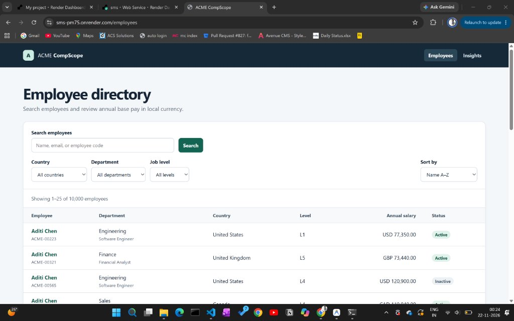
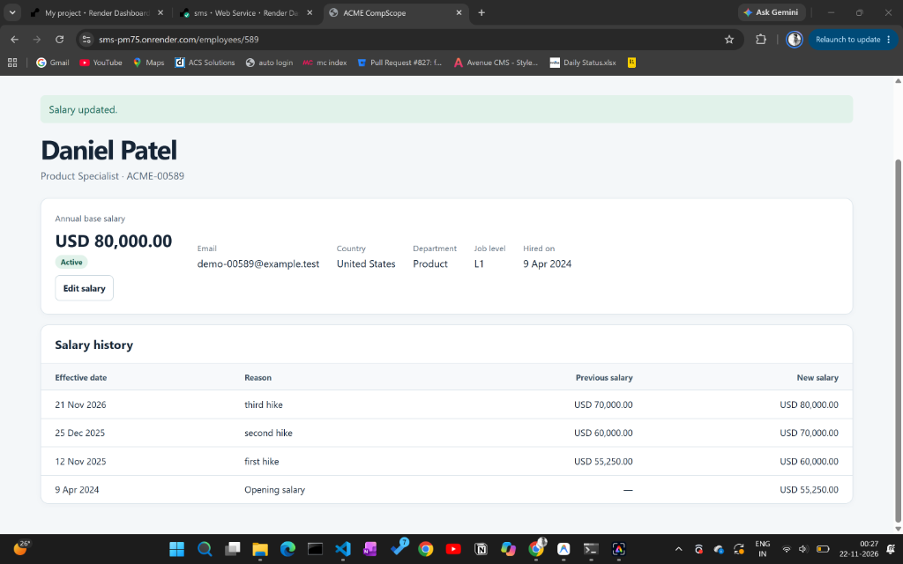
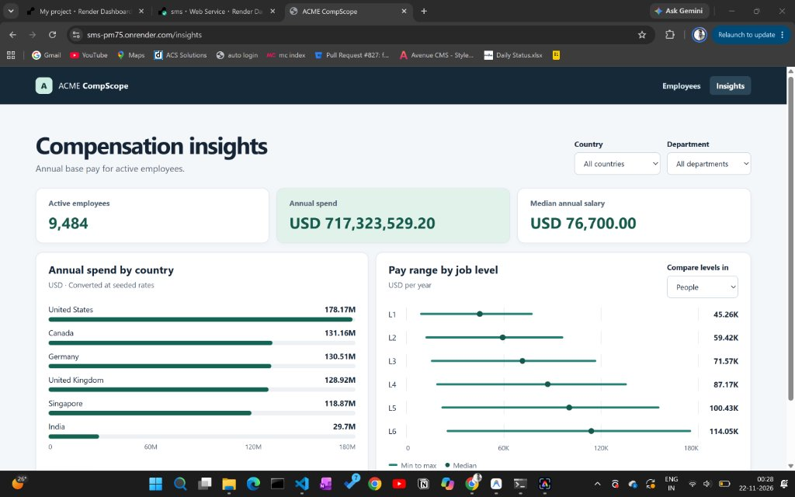

# ACME CompScope

Employee salary management for ACME HR. Search the directory, then open a profile to review or edit annual base pay and see the salary history. Open **Insights** for active headcount, annual spend, and pay by country, department, and level.

## Live Demo

- **Application URL:** <https://sms-pm75.onrender.com>
- **Health Check:** <https://sms-pm75.onrender.com/up>
- **Employee Directory:** <https://sms-pm75.onrender.com/employees>
- **Compensation Insights:** <https://sms-pm75.onrender.com/insights>

*Note: Hosted on Render with managed PostgreSQL. If the free web instance has been idle for 15+ minutes, the first request may take ~30–45 seconds to wake up.*

## Demo Walkthrough & Screenshots

- 🎥 **Video Demo Walkthrough:** [Watch the Video Walkthrough on Google Drive](https://drive.google.com/file/d/1s7PKuAr0jb5oGClKyngh3RxdK3bwgfMi/view?usp=sharing)

### 1. Employee Directory (10,000 Seeded Employees with SQL Search & Filters)


### 2. Employee Profile, Audit Trail & Salary Edit Form


### 3. Compensation Insights (Country Spend & Percentile Salary Ranges)


## Run locally

Install Ruby 4.0.9 with Bundler and Node.js 22.12 or newer. Start PostgreSQL and use a local role that can create the development and test databases. Rails connects to `127.0.0.1:5432` by default. Set `PGUSER` and supply its password through `PGPASSWORD` or a PostgreSQL password file. Set `PGHOST` or `PGPORT` if PostgreSQL uses a different address.

For example, in PowerShell, replace `your_local_role` with your PostgreSQL username.

```powershell
$env:PGUSER = "your_local_role"
$credential = Get-Credential -UserName $env:PGUSER -Message "Local PostgreSQL login"
$env:PGPASSWORD = $credential.GetNetworkCredential().Password
```

Start Rails from the repository root in the terminal with your PostgreSQL credentials.

```sh
bundle config set --local path vendor/bundle
bundle install
bundle exec rails db:create
bundle exec rails db:migrate
bundle exec rails server
```

In a second terminal, start Vite.

```sh
cd frontend
npm ci
npm run dev
```

Open <http://localhost:5173>. Vite reloads React changes and proxies `/api` requests to Rails on port 3000. On Windows PowerShell, use `npm.cmd` for these commands if script execution is disabled.

## Load demo data

Run this from the repository root after migrating the database.

```sh
bundle exec rails db:seed
```

On an empty database, the seed creates 10,000 synthetic employees across six countries and one opening salary revision for each employee. Rerunning it inserts missing demo employees with their opening revisions and preserves existing salaries, rates, and history.

## Run checks

Install Chrome for the browser smoke test. Selenium can download the matching ChromeDriver on the first run. On Linux, you can use Chromium and its matching driver on `PATH` and set `CHROME_BIN` to the Chromium executable.

```sh
npm --prefix frontend ci
npm --prefix frontend run build
bundle exec rubocop
bundle exec rspec
```

Run these commands from the repository root. The build writes to `public/frontend/`. The browser specs cover the directory, salary edits, and the effect of a raise on Insights. GitLab CI builds the same artifact, then runs RuboCop, PostgreSQL migrations, and RSpec with headless Chromium.

To preview the deployment layout locally, build the frontend and open <http://localhost:3000> with Rails running.

## Deploy the demo

1. **Database:** Render managed PostgreSQL database (`acme-compscope-db`).
2. **Web Service:** Render Web Service (`sms-pm75`) running Ruby on Rails 8 and serving the Vite-compiled React frontend from a single origin.
3. **Build & Start Pipeline:**
   - **Build Command:** `bundle install && npm --prefix frontend ci --include=dev && npm --prefix frontend run build`
   - **Start Command:** `bundle exec rails db:migrate db:seed && bundle exec rails server -b 0.0.0.0 -p "$PORT"`
   - Each deploy automatically runs pending migrations and the idempotent 10,000 synthetic employee seed while preserving reviewer edits and salary revision history.
4. **Verification:** Verify `/up`, directory search, employee detail, and filtered Insights links. Updating an employee's salary appends a revision, increments spend, and persists across server restarts.

## Project documents

- [Product requirements](docs/PRD.md)
- [System design](docs/DESIGN.md)
- [AI workflow log](docs/AI_WORKFLOW.md)
