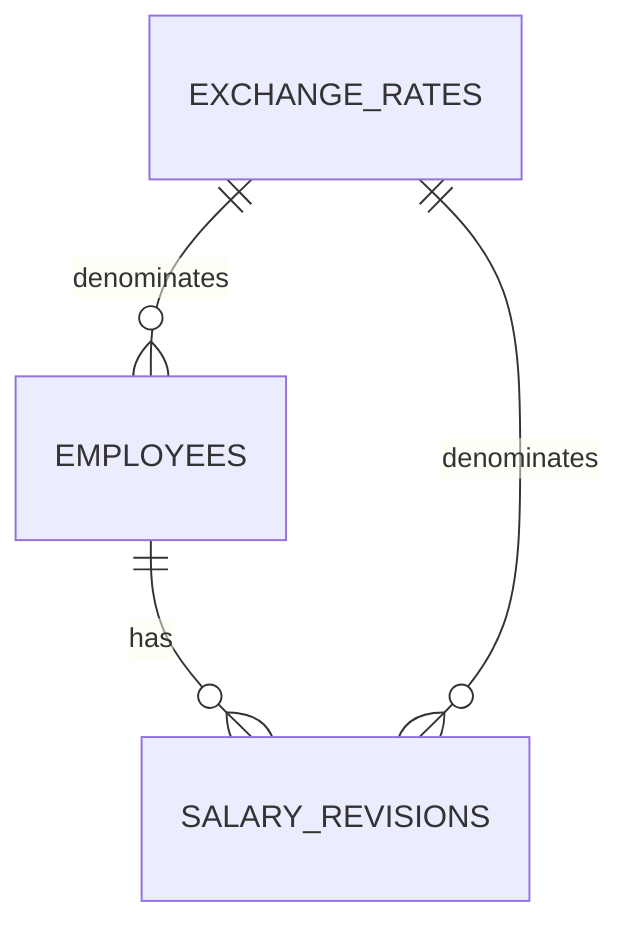

# ACME Salary Management — Design Notes

## Application boundary

Rails 8 provides the backend and JSON API. React components in `frontend/src/` use JSX for the directory, salary form, and insights. They call relative API URLs such as `/api/v1/employees`.

**Local development.** Start PostgreSQL and run `bundle exec rails server` from the repository root. Run `npm run dev` from `frontend/` in a second terminal. Open Vite at `http://localhost:5173`. Vite proxies `/api` to Rails on port 3000.

**Deployment.** In a build environment with Node.js and Ruby, run `npm --prefix frontend ci` and `npm --prefix frontend run build`. Vite writes versioned assets under `public/frontend/`. Start Rails with `bundle exec rails server -e production -b 0.0.0.0 -p "$PORT"`, using the port assigned by the host. Rails serves the built UI and API on one origin. Neon PostgreSQL stores the synthetic demo data and preserves reviewer edits across server restarts.

## Data model



| Table | What it owns |
| --- | --- |
| `exchange_rates` | ISO currency code as primary key and a positive `NUMERIC(12,6)` rate expressed as USD per local unit. Seed one fixed rate per supported currency, with USD equal to 1. |
| `employees` | Unique employee code and email, name, country, department, title, level, hire date, status, current annual salary, and currency. Salary is positive `NUMERIC(14,2)`. Foreign keys enforce valid currencies. |
| `salary_revisions` | Employee, previous and new salary, currency, reason, effective date, and creation time. At most one revision per employee can omit the previous salary. That row records the opening salary. Rails treats persisted revisions as read-only. |

### Exchange rate direction

Each rate answers "how many USD is 1 unit of this currency worth?"

| Currency | `rate_to_usd` | Meaning |
|----------|---------------|---------|
| USD | 1.000000 | 1 USD = 1.000000 USD |
| INR | 0.012000 | 1 INR = 0.012000 USD |
| GBP | 1.270000 | 1 GBP = 1.270000 USD |
| EUR | 1.080000 | 1 EUR = 1.080000 USD |
| CAD | 0.740000 | 1 CAD = 0.740000 USD |
| SGD | 0.740000 | 1 SGD = 0.740000 USD |

### Column reference

```
exchange_rates
  currency_code  VARCHAR  PK
  rate_to_usd    NUMERIC(12,6)  CHECK > 0

employees
  id              BIGINT  PK
  employee_code   VARCHAR  UNIQUE NOT NULL
  full_name       VARCHAR  NOT NULL
  email           VARCHAR  UNIQUE NOT NULL
  country_code    VARCHAR  NOT NULL
  department      VARCHAR  NOT NULL
  job_title       VARCHAR  NOT NULL
  job_level       VARCHAR  NOT NULL          -- L1 through L6
  annual_salary   NUMERIC(14,2)  CHECK > 0
  currency_code   VARCHAR  FK → exchange_rates
  status          VARCHAR  DEFAULT 'active'  -- active | inactive
  hired_on        DATE     NOT NULL
  created_at      TIMESTAMP
  updated_at      TIMESTAMP

salary_revisions
  id              BIGINT  PK
  employee_id     BIGINT  FK → employees  NOT NULL
  previous_salary NUMERIC(14,2)             -- NULL for opening revision
  new_salary      NUMERIC(14,2)  NOT NULL
  currency_code   VARCHAR  FK → exchange_rates
  reason          VARCHAR  NOT NULL
  effective_date  DATE     NOT NULL
  created_at      TIMESTAMP
```

### Indexes

| Index | Columns | Rationale |
|-------|---------|-----------|
| `idx_employees_on_status` | `status` | Filter active employees for analytics |
| `idx_employees_on_country_dept_level` | `country_code, department, job_level` | Composite filter for directory and grouped analytics |
| `idx_salary_revisions_on_employee_id` | `employee_id` | Fast lookup of an employee's revision history |
| `idx_salary_revisions_one_opening` | Unique `employee_id` where `previous_salary IS NULL` | Prevent duplicate opening revisions |

## API and consistency

| Route | Responsibility |
| --- | --- |
| `GET /api/v1/employees` | Case-insensitive substring search by name, email, or code through `q`. Combine `country`, `department`, and `job_level` filters in SQL. Return employees, pagination, and directory-wide filter options. |
| `GET /api/v1/employees/:id` | Return current pay, hire date, the allowed salary effective dates, and revisions ordered by effective date, creation time, and ID, newest first. Return `latest_revision_id` as `null` when history is empty. |
| `PATCH /api/v1/employees/:id/salary` | Accept JSON with `annual_salary` as a decimal string, `reason`, `effective_date` as YYYY-MM-DD, and `expected_revision_id` from the profile. Return the saved revision. |
| `GET /api/v1/analytics` | Return filtered active headcount, spend, country breakdowns, and department/level ranges. |

The directory accepts `sort` values `name`, `employee_code`, `department`, and `job_level`, plus `direction=asc` or `desc`. The default is ascending name, and all sorts break ties by ascending employee ID. Pagination starts at page 1 with 25 records per page and accepts up to 100. Invalid sort or pagination parameters return 400. An unknown employee ID returns 404.

The profile reads pay and the revision token under a shared employee row lock. A salary write takes an exclusive lock, checks the token, and saves both the new pay and revision in a single transaction. Any failure rolls back the transaction. The employee keeps their current currency. The earliest effective date is the latest revision's effective date, or the hire date if the employee has no history. Both the earliest date and today's Rails application date are inclusive.

A stale token returns HTTP 409 and the form offers to reload the latest pay. Invalid input returns 422 with field errors, and submitted values stay in the form. A successful save refreshes both the profile and directory.

## Money and reporting

Store money as decimals and serialize amounts as strings in JSON. Validate salary input before Active Record rounds to cents. PostgreSQL rejects nonpositive pay and rates, including numeric `NaN`. For global spend, sum each active employee's local salary multiplied by its USD rate, then round the displayed total. Country rows carry local and USD figures. Department/level ranges use local currency within one country and USD across countries.

PostgreSQL computes counts, sums, and medians on the filtered rows. For example, a test group earning USD 60,000 and INR 2,000,000 at 0.012 USD per INR has USD 84,000 in spend and a USD 42,000 median. This checks both rate direction and the mean of the two middle salaries. An empty group has zero spend and no median.

## Verification and scale

Use hand-calculated RSpec fixtures for FX, medians, effective dates, stale edits, and rollback. Use focused RSpec system specs with a JavaScript-enabled browser to check the currency shown and the salary form's response to invalid input. Bulk-seed 10,000 employees with a fixed random seed and stable employee codes. Verify a rerun preserves reviewer edits. Measure seed time against the five-second target and time directory and insights queries on the full dataset before tuning indexes.

The seed uses batches of 500. Each transaction inserts opening revisions for the employees returned by that batch's insert. On Windows with Ruby 4.0.9 and local PostgreSQL 18, the seed body took 2.09 seconds on a fresh database. The full `rails db:seed` command took 5.88 seconds on the first run and 5.19 seconds on the rerun, including Rails startup.

With 10,000 seeded employees in the same environment, the median of five warm in-process Rails requests was 19.60 ms for 25 rows, 18.96 ms for 100 rows, 20.68 ms for an employee-code search, and 14.09 ms for combined country, department, and level filters. Each measured request used five employee queries for the count, page, and shared filter options.
